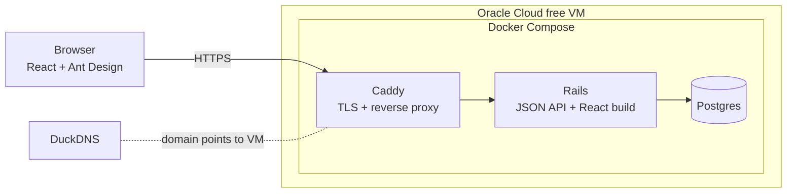
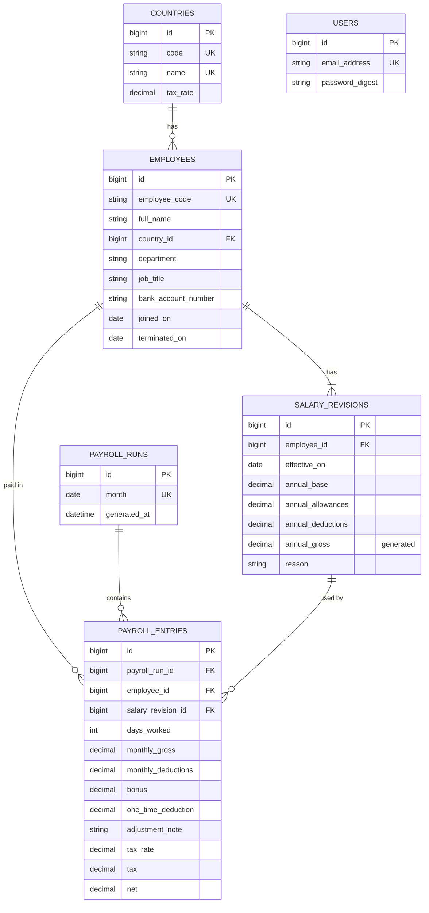

# Salary Management — Architecture

Scope, rules and formulas are defined in [requirements.md](requirements.md). This document covers how the app is built.

## 1. System

- **One Rails app** serves both the JSON API (`/api/*`) and the compiled React build for every other path. The browser and API share a domain, so login uses a normal session cookie.
- **Caddy** terminates HTTPS, getting certificates automatically for the DuckDNS domain, and proxies to Rails.
- **Postgres** runs in its own container, with its data on a Docker volume so it survives redeploys.

## 2. Data model

All money columns are `decimal(12,2)`. Every column is `NOT NULL` unless marked nullable. Every foreign key has a DB constraint and an index.

| Table | Columns | Constraints and indexes |
|---|---|---|
| `users` | `email_address`, `password_digest` | unique `email_address`. Created by Rails 8's authentication generator. The HR login only, not linked to `employees`. |
| `sessions` | `user_id`, `ip_address`, `user_agent` | foreign key and index on `user_id`. One row per login, deleted on logout. |
| `countries` | `code` (ISO 2), `name`, `tax_rate decimal(5,4)` | unique `code`, unique `name`, check `tax_rate BETWEEN 0 AND 1` |
| `employees` | `employee_code`, `full_name`, `country_id`, `department`, `job_title`, `bank_account_number`, `joined_on`, `terminated_on` (nullable) | unique `employee_code`. Indexes on `country_id`, `department`, `job_title`, `joined_on`, `terminated_on`. Check `terminated_on >= joined_on`. |
| `salary_revisions` | `employee_id`, `effective_on`, `annual_base`, `annual_allowances`, `annual_deductions`, `annual_gross`, `reason` | unique `(employee_id, effective_on)`, which also serves "latest revision" lookups. Checks that amounts are `>= 0`. `annual_gross` is a stored generated column: `annual_base + annual_allowances`. `reason` is one of `initial`, `increment`, `promotion`, `correction` or `other`, enforced by a check constraint. |
| `payroll_runs` | `month`, `generated_at` | unique `month`, check that `month` is the 1st |
| `payroll_entries` | `payroll_run_id`, `employee_id`, `salary_revision_id`, `days_worked`, `monthly_gross`, `monthly_deductions`, `bonus` (default 0), `one_time_deduction` (default 0), `adjustment_note` (nullable), `tax_rate decimal(5,4)`, `tax`, `net` | unique `(payroll_run_id, employee_id)`, index on `employee_id` and `salary_revision_id`. Check that `days_worked` is between 1 and 31 and that `bonus` and `one_time_deduction` are `>= 0`. |

`payroll_entries` is the only stored payroll. It doesn't copy the revision's amounts, because revisions never change and the entry already has `salary_revision_id`. Taxable (`monthly_gross + bonus`) and days in the month (from the run's month) are calculated when needed, so they aren't stored.

**Derived values, not stored:**
- **Status:** `active` if `joined_on <= today` and (`terminated_on` is null or `>= today`), `upcoming` if `joined_on > today`, `terminated` if `terminated_on < today`. This keeps future joiners out of both the headcount and the salary stats.
- **Locked month:** a month is locked if it's earlier than `MAX(payroll_runs.month)`.
- **Current salary:** the latest revision with `effective_on <= today`.

## 3. Services

| Service | Responsibility |
|---|---|
| `Payroll::EntryCalculator` | A plain Ruby object with `BigDecimal` and the rounding rule, and no DB access, so it's fast to test. It has two steps: **Prorate:** revision + month + employee dates → days worked, monthly gross, monthly deductions. **Settle:** monthly gross, monthly deductions, tax rate, bonus and one-time deduction → tax and net. Generation uses both steps. Editing an adjustment uses only Settle. |
| `Payroll::Generator` | Creates or recalculates a month's run in one transaction. It checks the month rules, loads eligible employees in batches with the revision in effect on their last day worked, uses `EntryCalculator`, and upserts the entries without touching HR's bonus, deduction or note. |
| `Payroll::Exporter` | Builds the Excel file for one run from its stored entries, with no recalculation. |
| `SalaryStatsQuery` (`app/queries`) | Runs every dashboard aggregate in SQL in one place: count, sum, min, max, average and median (`percentile_cont(0.5)`) of `annual_gross` for active employees, with optional filters and an optional `group_by`. |
| `Employees::Importer` | Reads the uploaded Excel file, validates each row, inserts each valid employee together with their first revision, and returns counts plus per-row errors. |

Revision and termination rules live in model validations, with matching DB constraints where possible. `PayrollRun.locked?(month)` is the single check for locked months, used by the generator, entry updates and termination.

## 4. API

The API returns JSON under `/api`. Every endpoint except `GET` and `POST /api/session` requires a login. The React page and `/up` are open.

**Auth:**
- **Session:** Rails 8's authentication generator, trimmed to JSON (no password reset, mailer or HTML views). Login sets a signed, httponly, `SameSite=Lax` `session_id` cookie that expires after 1 day. Rails signs the expiry into the cookie, so the server rejects an expired cookie even if it's sent back.
- **CSRF:** Rails' built-in protection. `GET /api/session` and the login response return the token, and React sends it as `X-CSRF-Token` on every non-GET request. The session is reset on login and logout, so the token rotates. Both responses return the new token.
- **Login errors:** a wrong password and an unknown email give the same 401 response.
- **Rate limit:** 10 login attempts per IP per 3 minutes, then 429. Counts are kept in their own in-memory store, which is fine for a single Puma process.
- **Seed:** one HR user from `HR_EMAIL` / `HR_PASSWORD`, defaulting to `hr@example.com` / `password` for local use.

| Method | Path | Purpose |
|---|---|---|
| GET | `/api/session` | Login status, the user and a CSRF token. Open without login, so React can check after a refresh. |
| POST / DELETE | `/api/session` | Log in (open, rate limited) / log out. Both return a new CSRF token. |
| GET | `/api/employees?q=&country_id=&department=&job_title=&status=&page=` | Paginated list, with the bank account masked |
| GET | `/api/employees/:id` | Employee details and revision history |
| POST | `/api/employees/:id/salary_revisions` | Add a revision, with a reason |
| POST | `/api/employees/:id/termination` | Terminate, with `terminated_on` |
| POST | `/api/employee_imports` | Upload an Excel file, returns the import report |
| GET | `/api/filter_options` | Countries, departments and job titles for the dropdowns |
| GET | `/api/insights?country_id=&department=&job_title=&group_by=` | Dashboard stats, optionally grouped |
| GET / PATCH | `/api/countries`, `/api/countries/:id` | List countries and tax rates / update a tax rate |
| GET | `/api/payroll_runs` | List runs, with a `locked` flag on each and an `outdated` flag on the open run |
| PUT | `/api/payroll_runs/:month` | Generate, or recalculate if the run exists (`month` = `2026-10`) |
| GET | `/api/payroll_runs/:month/entries?page=` | Paginated entries, with the bank account masked |
| PATCH | `/api/payroll_runs/:month/entries/:id` | Set bonus, one-time deduction and note (open month only). Recalculates that entry. |
| GET | `/api/payroll_runs/:month/export` | Download the Excel file, with full bank account numbers |

**Errors** all use one format: `{ "error": { "code": "...", "message": "...", "details": { "field": ["..."] } } }`.

| Status | When |
|---|---|
| 400 | Missing request parameters |
| 401 | Not logged in, or wrong login |
| 404 | Not found |
| 409 | A locked month, a run for a future month, or a skipped month |
| 422 | A validation error, or a missing or invalid CSRF token |
| 429 | Too many login attempts |

**Lists** take `page` and `per_page` (default 25, maximum 100) and return `{ "data": [...], "meta": { "page", "per_page", "total" } }`.

## 5. Frontend pages

| Page | Shows |
|---|---|
| Login | Email and password |
| Dashboard | Filters, stat cards (headcount, total cost, min, max, average, median), and a chart grouped by country or department |
| Employees | A searchable, filterable, paginated table showing status and the masked bank account |
| Employee detail | Employee details, revision history with reasons (revisions dated after `terminated_on` marked as never applied), an "Add revision" modal and a "Terminate" modal |
| Import | File upload, then counts of imported, skipped and failed rows, plus an error table |
| Payroll | Month picker, "Generate" or "Recalculate" (with confirmation), runs list, entries table with negative net flagged and totals, bonus/deduction/note editing on entries of the open month, an "Outdated" badge when the open month needs recalculating, and Export |
| Countries | Tax rate per country, editable |

The UI only formats and displays values. Every amount comes from the API.

## 6. Main flows

**Generate or recalculate payroll**
1. HR picks a month. If a run already exists for the latest month, the UI asks for confirmation before recalculating.
2. `PUT /api/payroll_runs/:month` is called. The month is rejected if it's in the future, if it's locked, or if it's a new run that isn't exactly the month after the latest run. The first run ever can be for any month that isn't in the future.
3. In one transaction:
   - create the run if it doesn't exist
   - load the employees eligible that month (`joined_on <= month end` and (`terminated_on` is null or `>= month start`)) in batches, with the revision in effect on each employee's last day worked
   - for each employee, run Prorate, then Settle with the entry's existing bonus and deduction (0 for a new entry)
   - upsert the entries on `(payroll_run_id, employee_id)`, updating only the calculated columns. Entries are never deleted (see requirements).
   - set `generated_at`

**Outdated check (open month only)**

`PayrollRun#outdated?` is a single `EXISTS` query that is true if, after `generated_at`:
- a salary revision was created with `effective_on <= month end`, or
- an employee was created or updated (terminated), or
- a country's tax rate was updated

It's a little coarse (e.g. a termination in a later month also triggers it), but recalculating when it wasn't needed does no harm.

**Edit a bonus or deduction**
1. On the Payroll page, HR edits an entry of the open month.
2. `PATCH /api/payroll_runs/:month/entries/:id` is called. It's rejected if the month is locked.
3. Settle runs on the entry's stored monthly gross, monthly deductions and tax rate, and saves tax and net. Nothing else is recalculated.

**Excel import**
1. Upload the file to `POST /api/employee_imports`. Anything that isn't an `.xlsx` file, or is over 5 MB, is rejected with a 422 before parsing.
2. Validate each row: required fields, the country exists, dates and amounts are valid, the code is unique in the DB and within the file. Department and job title are trimmed.
3. Insert each valid row's employee and first revision (effective `joined_on`, reason `initial`). Report skipped rows ("already exists") and failed rows with their row number and reason.

**Add a revision**
1. HR enters the effective date, the annual base, allowances and deductions, and a reason.
2. The date is validated: no earlier than `joined_on`, no later than `terminated_on`, and not already used for this employee. The revision is saved as immutable. Existing payroll runs aren't touched.

**Terminate**
1. HR picks the last working day.
2. The date is validated: the employee isn't already terminated, and the date is no earlier than `joined_on` and not in a locked month. Future revisions don't block it. It's saved and can't be changed afterwards.

## 7. Key decisions

| Decision | Reason |
|---|---|
| Payroll entries are the only stored payroll, and adjustments live on them | A paid month must never change. An entry holds the revision used, the tax rate and the calculated amounts, so locked months stay fixed. Keeping adjustments on the entry avoids a separate table and matching it by month. |
| Revisions are immutable | They give a complete salary history, and a payroll entry can safely point to the revision it used. |
| One app serves the API and the React build | A single deployment and a single domain, so no cross-origin setup is needed and auth can use a session cookie. |
| Business logic lives in services | Controllers stay thin, and the rules can be tested without HTTP. |
| Payroll rules are in Ruby with `BigDecimal` | Proration, tax, rounding and net are the rules most likely to change, and plain Ruby is the easiest to change and test exactly. |
| Dashboard aggregates are in SQL, in one query object | Aggregating 10k rows belongs in the database. Keeping it in one object with its own specs means the logic isn't spread across the app. |
| `annual_gross` is a generated column | It's defined in one place and used by both payroll and the dashboard, so they can't disagree. |
| Department and job title are strings, country is a table | Department and job title are only labels. Country carries the tax rate. |
| Import is synchronous | 10k rows are fast enough within one request. Background jobs would add infrastructure for no benefit. |
| Locked and status are derived | No flags that can drift out of sync with the data. |

**Seed and performance:**
- `db/seeds/employee_seeder.rb` creates 6 countries and 10,000 employees with about 15,000 revisions, using a fixed random seed. Dates are calculated from today, so the data is the same for every run on the same day. It's bulk-inserted and takes about 2 seconds.
- `EXPLAIN ANALYZE` of the dashboard median query on the seeded data took 9 ms. It reads the current revisions through the unique `(employee_id, effective_on)` index. Before Postgres had refreshed its statistics after the bulk insert, the same query took 28 ms.
- Confirmed: Rails 8.1 returns the generated `annual_gross` right after insert, so no reload is needed.

**Follow-ups:**
- Payroll feature: add the locked-month check to termination (`Employee#terminate!`). It needs `payroll_runs`, which doesn't exist yet.

**To confirm at setup:**
- Gems for Excel read/write and pagination. Each needs approval.
- Deploy: the VM must use its own `SECRET_KEY_BASE` from its `.env`. The one in `docker-compose.yml` is public and only for local use.
- Deploy: `RAILS_HOSTS` must be set on the VM. If it's unset, Rails accepts any `Host` header.
- Deploy: set `HR_PASSWORD` on the VM. The default `password` is public in the README.
- Deploy: leave `WEB_CONCURRENCY` unset, so Puma runs one process. The login rate limit is counted in memory per process, so each extra worker would allow another 10 attempts.
- Whether `upsert_all` with `update_only` in the installed Rails version keeps HR's bonus, deduction and note untouched on recalculation.
