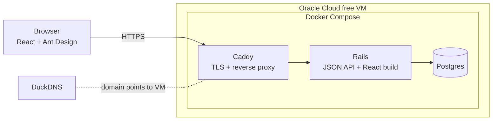
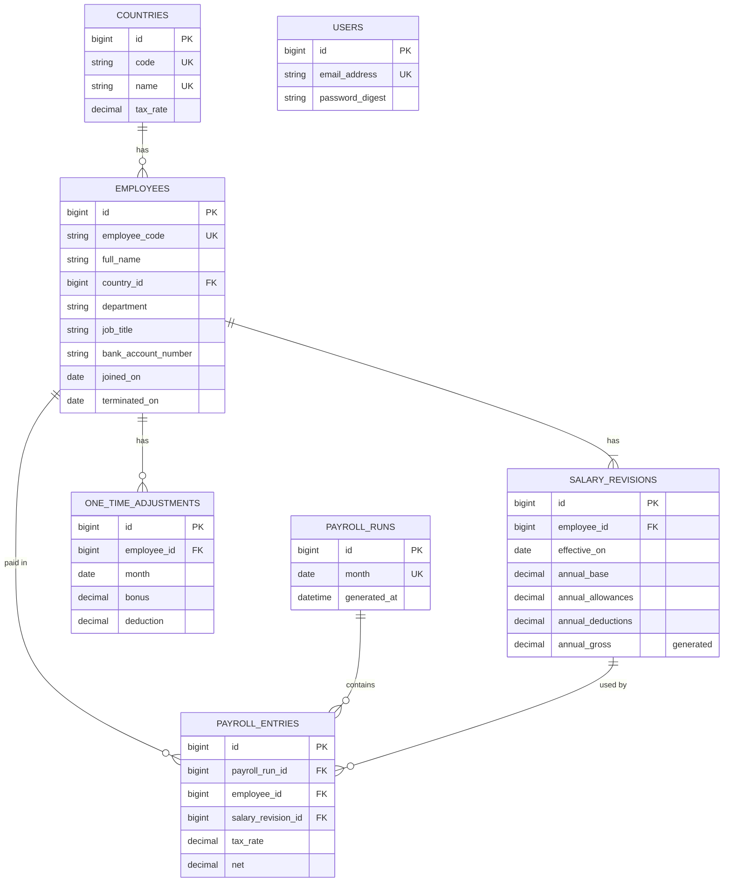

# Salary Management — Architecture

Scope, rules and formulas are defined in [requirements.md](requirements.md). This document covers how the app is built.

## 1. System

- **One Rails app** serves both the JSON API (`/api/*`) and the compiled React build for every other path. The browser and API share a domain, so login uses a normal session cookie.
- **Caddy** terminates HTTPS, getting certificates automatically for the DuckDNS domain, and proxies to Rails.
- **Postgres** runs in its own container, with its data on a Docker volume so it survives redeploys.

## 2. Data model

All money columns are `decimal(12,2)`. Every column is `NOT NULL` unless marked nullable. Every foreign key has a DB constraint and an index.

| Table | Columns | Constraints and indexes |
|---|---|---|
| `users` | `email_address`, `password_digest` | unique `email_address`. Rails 8's authentication generator also adds a `sessions` table (to confirm at setup). |
| `countries` | `code` (ISO 2), `name`, `tax_rate decimal(5,4)` | unique `code`, unique `name`, check `tax_rate BETWEEN 0 AND 1` |
| `employees` | `employee_code`, `full_name`, `country_id`, `department`, `job_title`, `bank_account_number`, `joined_on`, `terminated_on` (nullable) | unique `employee_code`. Indexes on `country_id`, `department`, `job_title`, `terminated_on`. Check `terminated_on >= joined_on`. |
| `salary_revisions` | `employee_id`, `effective_on`, `annual_base`, `annual_allowances`, `annual_deductions`, `annual_gross` | unique `(employee_id, effective_on)`, which also serves "latest revision" lookups. Checks that amounts are `>= 0`. `annual_gross` is a stored generated column: `annual_base + annual_allowances`. |
| `one_time_adjustments` | `employee_id`, `month`, `bonus` (default 0), `deduction` (default 0) | unique `(employee_id, month)`. Check that `month` is the 1st and amounts are `>= 0`. |
| `payroll_runs` | `month`, `generated_at` | unique `month`, check that `month` is the 1st |
| `payroll_entries` | `payroll_run_id`, `employee_id`, `salary_revision_id`, plus the snapshot columns below | unique `(payroll_run_id, employee_id)`, index on `employee_id` |

`payroll_entries` snapshot columns:
- **Revision values:** `annual_base`, `annual_allowances`, `annual_deductions`, `annual_gross`
- **Tax and proration:** `tax_rate`, `days_worked`, `days_in_month`
- **Amounts:** `monthly_gross`, `monthly_deductions`, `bonus`, `one_time_deduction`, `taxable`, `tax`, `net`

**Derived values, not stored:**
- **Status:** an employee is active if `terminated_on` is null or on or after today.
- **Locked month:** a month is locked if it's earlier than `MAX(payroll_runs.month)`.
- **Current salary:** the latest revision with `effective_on <= today`.

## 3. Services

| Service | Responsibility |
|---|---|
| `Payroll::EntryCalculator` | A plain Ruby object. Takes one employee's revision, tax rate, month and adjustment, and returns days worked and every amount (gross, deductions, taxable, tax, net), using `BigDecimal` and the rounding rule. Has no DB access, so it's fast to test. |
| `Payroll::Generator` | Creates or recalculates a month's run in one transaction. It checks the month rules, loads payable employees in batches with their revision and adjustment, uses `EntryCalculator`, and bulk-inserts the entries. |
| `Payroll::Exporter` | Builds the Excel file for one run from its stored entries. |
| `SalaryStatsQuery` (`app/queries`) | Runs every dashboard aggregate in SQL in one place: count, sum, min, max, average and median (`percentile_cont(0.5)`) of `annual_gross` for active employees, with optional filters and an optional `group_by`. |
| `Employees::Importer` | Reads the uploaded Excel file, validates each row, inserts each valid employee together with their first revision, and returns counts plus per-row errors. |

Revision and termination rules live in model validations, with matching DB constraints where possible. `PayrollRun.locked?(month)` is the single check for locked months, used by the generator, adjustments and termination.

## 4. API

The API returns JSON under `/api`. Every endpoint except login requires a session.

| Method | Path | Purpose |
|---|---|---|
| POST / DELETE | `/api/session` | Log in / log out |
| GET | `/api/employees?q=&country_id=&department=&job_title=&status=&page=` | Paginated list, with the bank account masked |
| GET | `/api/employees/:id` | Employee details, revisions and adjustments |
| POST | `/api/employees/:id/salary_revisions` | Add a revision |
| POST | `/api/employees/:id/termination` | Terminate, with `terminated_on` |
| PUT | `/api/employees/:id/adjustments/:month` | Create or update that month's bonus and deduction |
| POST | `/api/employee_imports` | Upload an Excel file, returns the import report |
| GET | `/api/filter_options` | Countries, departments and job titles for the dropdowns |
| GET | `/api/insights?country_id=&department=&job_title=&group_by=` | Dashboard stats, optionally grouped |
| GET / PATCH | `/api/countries`, `/api/countries/:id` | List countries and tax rates / update a tax rate |
| GET | `/api/payroll_runs` | List runs, with a `locked` flag on each |
| PUT | `/api/payroll_runs/:month` | Generate, or recalculate if the run exists (`month` = `2026-10`) |
| GET | `/api/payroll_runs/:month/entries?page=` | Paginated entries |
| GET | `/api/payroll_runs/:month/export` | Download the Excel file, with full bank account numbers |

**Errors** all use one format: `{ "error": { "code": "...", "message": "...", "details": { "field": ["..."] } } }`.

| Status | When |
|---|---|
| 401 | Not logged in |
| 404 | Not found |
| 409 | A locked month, or a run for a future month |
| 422 | A validation error |

**Lists** return `{ "data": [...], "meta": { "page", "per_page", "total" } }`.

## 5. Frontend pages

| Page | Shows |
|---|---|
| Login | Email and password |
| Dashboard | Filters, stat cards (headcount, total cost, min, max, average, median), and a chart grouped by country or department |
| Employees | A searchable, filterable, paginated table showing status and the masked bank account |
| Employee detail | Employee details, revision history, an "Add revision" modal, a "Terminate" modal, and one-time adjustments for open months |
| Import | File upload, then counts of imported, skipped and failed rows, plus an error table |
| Payroll | Month picker, "Generate" or "Recalculate" (with confirmation), runs list, entries table with negative net flagged, totals and Export |
| Countries | Tax rate per country, editable |

The UI only formats and displays values. Every amount comes from the API.

## 6. Main flows

**Generate or recalculate payroll**
1. HR picks a month. If a run already exists for the latest month, the UI asks for confirmation before recalculating.
2. `PUT /api/payroll_runs/:month` is called. The month is rejected if it's in the future or locked.
3. In one transaction:
   - create the run, or delete the existing run's entries
   - load the employees payable that month (`joined_on <= month end` and (`terminated_on` is null or `>= month start`)) in batches, with the revision in effect on each employee's last day worked and that month's adjustment
   - calculate each entry
   - bulk-insert the entries
   - set `generated_at`

**Excel import**
1. Upload the file to `POST /api/employee_imports`.
2. Validate each row: required fields, the country exists, dates and amounts are valid, the code is unique in the DB and within the file. Department and job title are trimmed.
3. Insert each valid row's employee and first revision (effective `joined_on`). Report skipped rows ("already exists") and failed rows with their row number and reason.

**Add a revision**
1. HR enters the effective date and the annual base, allowances and deductions.
2. The date is validated: no earlier than `joined_on`, no later than `terminated_on`, and not already used for this employee. The revision is saved as immutable. Existing payroll runs aren't touched.

**Terminate**
1. HR picks the last working day.
2. The date is validated: the employee isn't already terminated, and the date is no earlier than `joined_on` or the latest revision's date and not in a locked month. It's saved and can't be changed afterwards.

## 7. Key decisions

| Decision | Reason |
|---|---|
| Payroll is stored, with a snapshot on each entry | A paid month must never change. The snapshot keeps locked months fixed even after later revisions or tax-rate changes. |
| Revisions are immutable | They give a complete salary history, and a payroll entry can safely point to the revision it used. |
| One app serves the API and the React build | A single deployment and a single domain, so no cross-origin setup is needed and auth can use a session cookie. |
| Business logic lives in services | Controllers stay thin, and the rules can be tested without HTTP. |
| Payroll rules are in Ruby with `BigDecimal` | Proration, tax, rounding and net are the rules most likely to change, and plain Ruby is the easiest to change and test exactly. |
| Dashboard aggregates are in SQL, in one query object | Aggregating 10k rows belongs in the database. Keeping it in one object with its own specs means the logic isn't spread across the app. |
| `annual_gross` is a generated column | It's defined in one place and used by both payroll and the dashboard, so they can't disagree. |
| Department and job title are strings, country is a table | Department and job title are only labels. Country carries the tax rate. |
| Import is synchronous | 10k rows are fast enough within one request. Background jobs would add infrastructure for no benefit. |
| Locked and status are derived | No flags that can drift out of sync with the data. |

**To confirm at setup:**
- Gems for Excel read/write and pagination. Each needs approval.
- What exactly Rails 8's authentication generator creates.
- Whether Rails returns the generated `annual_gross` value right after insert, or whether the record has to be reloaded.
